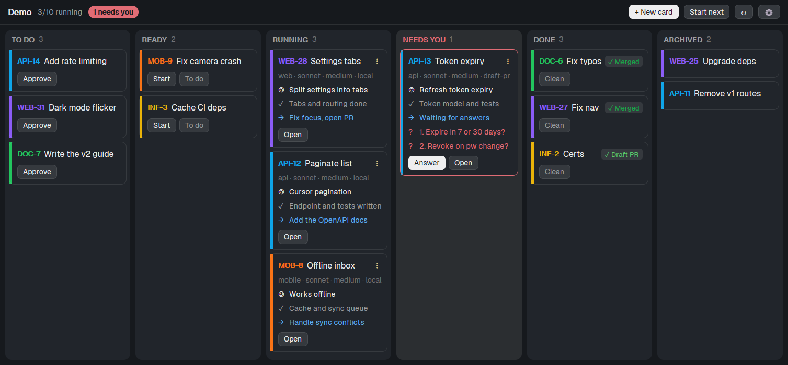
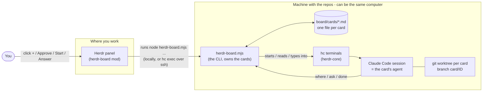
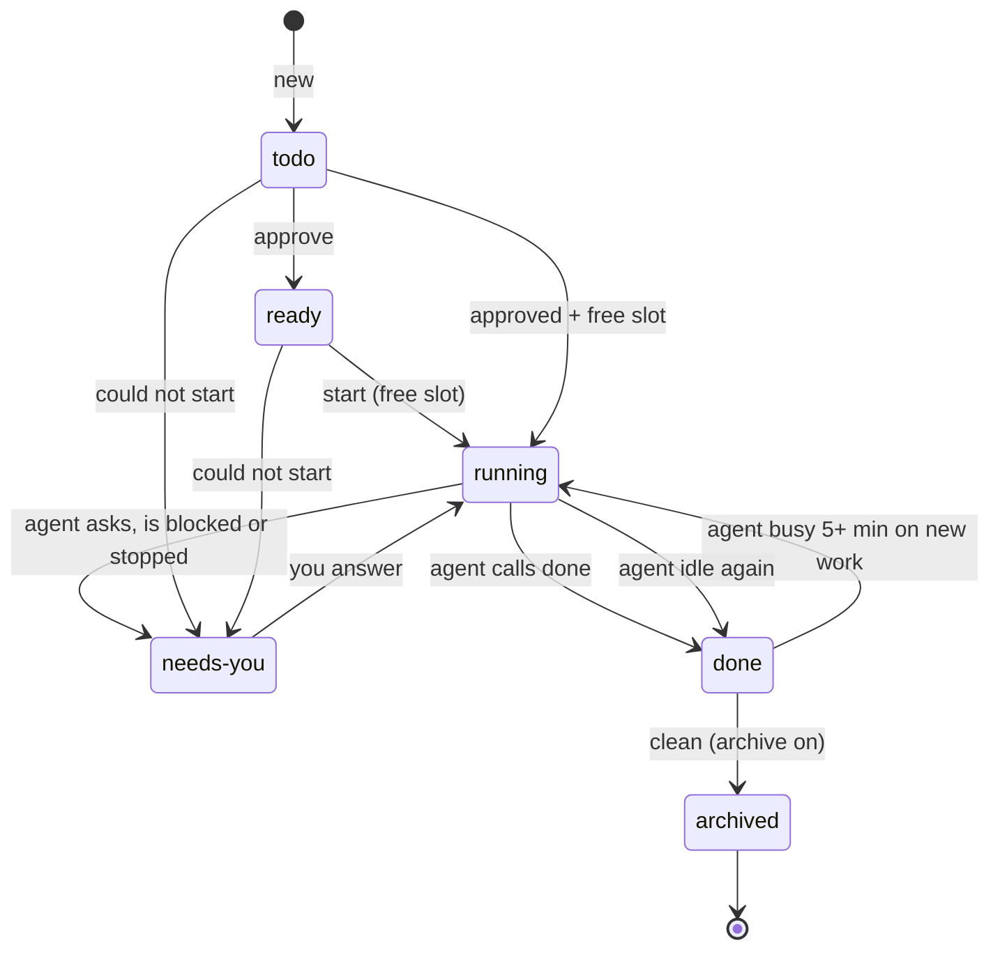

# herdr-board

**A kanban board where every card is a Claude Code agent.**

You write what you want on a card. herdr-board starts a real, interactive [Claude Code](https://claude.com/claude-code)
session for it, in its own git worktree, and keeps it on track. The agent works alone, tells you in a few lines where
it is, asks all its questions at once when it is stuck, and stops at the "done" target you chose (a local commit, a
draft PR, a merged PR...). You run several cards at once and look only at the ones that need you.



- **Every card is a Markdown file.** Plain text, easy to read, edit, and version.
- **Every agent is a normal session.** Open it from the card at any time and type into it: your words win over the card.
- **Every card has its own worktree and branch** (`card/<id>`), so agents never step on each other or on your checkout.
- **No database, no packages.** One Node file (`herdr-board.mjs`) and a panel for Herdr.

## How it works



The panel is only a **view**: every button runs a command of the CLI, which reads and writes the card files and drives
the terminals through `hc`. Nothing else holds state, so you can also run everything from a shell (see [Commands](#commands)).

### The life of a card



1. **Write** a card: Context, Constraints, and "Done looks like". **Create with agent** can help you fill it in.
2. **Approve** the card. Pick a model and effort, or leave them on Auto: a one-shot Haiku call chooses them and says why on the card.
3. **Start**: when a slot is free (`maxParallel`), the CLI creates the worktree, opens a terminal, starts Claude Code and
   gives it the card and the rules in `rules.md`. Auto-start can do this for you.
4. **Work**: the agent keeps three short lines up to date (◎ goal, ✓ done, → next) so you can get back into the topic in seconds.
5. **Ask**: if blocked, it sends all its questions in one go; the card moves to **Needs you**. You answer on the card,
   the answers go to the live session, and it continues.
6. **Done**: it reaches the card's target (below) and reports what changed. The session stays open if you want to come back.
7. **Clean**: removes the worktree and branch and archives the card.

### The done targets

Each card says how far the agent must go:

| Target | The agent stops when |
|---|---|
| `none` | it has answered (investigation, Q&A) |
| `local` | the change is committed on its branch |
| `local-reviewed` | committed and reviewed by itself |
| `draft-pr` | the branch is pushed and a draft PR is open |
| `pr-ready` | the PR is reviewed and its checks pass |
| `merged` | the PR is merged |

### A card, as a file

```markdown
---
id: API-12
title: Add rate limiting
repo: billing-api
status: running
done: draft-pr
model: sonnet
---

## Context
Clients can hammer /charge. Add a per-key limit.

## Constraints
- Do not change the public response format.

## Done looks like
A limit of 60 requests/min per key, with tests.

## Where we are
◎ Add per-key rate limit   ✓ Middleware written   → Write tests
```

The tool rewrites a **Next action** section at the top of each card, so you always know whether something is on you.

## Quick start

1. Install Herdr, `hc`, Node 18+, git and Claude Code (and `gh` for pull-request targets). See [What you need](#what-you-need).
2. Try it on **one computer**: leave Machine empty in the panel settings and point *Board CLI* at `herdr-board.mjs` in this checkout.
3. Create a board folder with a `board.json` that lists your repos ([example](#boardjson)).
4. Run `./install.sh`, pick the `board` layout with `Ctrl+Shift+L`, open ⚙ → Boards and fill in the paths.
5. Click **+**, write a card, approve, **▶ Start next**.

For a separate machine, run `./deploy.sh <machine> <folder>` to copy the CLI there.

---

# Reference

## What you need

- The Herdr app and herdr-core (`hc` on your PATH), on the computer you work at and on the machine with the repos
  (they can be the same computer).
- Node 18+, git and Claude Code on the machine with the repos.
- `gh` (GitHub CLI), logged in, if you use the pull-request done targets.

## Install

1. **Where the repos are ("the server")**: create a board folder with a `board.json` (see below), then
   `./deploy.sh <machine> <folder>` copies the CLI there (`<machine>` is a name from `hc machine ls`).
2. **Where you work (the laptop)**: `./install.sh` installs the panel and the layout into Herdr. Pick the layout
   with `Ctrl+Shift+L`, open ⚙ → Boards and set the machine, the path of `herdr-board.mjs` and the board folder.

## Daily use

Click **+** to make a card, fill in Context / Constraints / Done looks like, approve, **Start next**.
Cards that need you move to **Needs you**: answer there. The command line does the same (see Commands).

**Card creator skill.** In any Claude Code session, ask "create a card for ...". The `card-creator` skill (`skills/card-creator/SKILL.md`)
turns your request into a card with the template's sections (Context, Constraints, Done looks like), a done target,
and a model and effort it chooses itself. It shows you the card, asks "Create it?", then runs `new --fields-file`. It never
approves the card. Because model and effort are already set, no Haiku call is made when you approve. Cards you create by
hand, with the model left empty, still go through the Auto choice. `./install.sh` copies the skill to `~/.claude/skills/`
(or `$CLAUDE_HOME/skills/`); to use it where the CLI runs (the server), copy the `card-creator` folder there by hand.

## Layout on the server

```
board/                       the board folder, on the server
  board.json                 repos, colors, max parallel agents, auto-start, Herdr space
  cards/DEMO-1.md            one card per file
<folder>/                    the code, copied there by ./deploy.sh <machine> <folder>
  herdr-board.mjs            the CLI (Node, no packages)
  check.mjs                  validates a change locally and over the fake SSH machine
  rules.md                   what every card agent is told (autonomy, questions, done targets)
  card-template.md           a new card
  draft-rules.md             what the "Create with agent" chat is told
```

## Flow

`new` → you fill in Context / Constraints / Done looks like → `approve` (model and effort may be left on Auto: Haiku picks them) (or `approved: true` on the card) → `next` starts cards by id while slots are free
→ the agent works, keeps "Where we are" up to date, and either
`ask`s (all its questions at once; card goes to **needs-you**) or calls `done`.
→ you write answers under `## Answers` and run `answer <id>` (or `answer <id> "text"`); the agent continues.
`ask` and `done` start the next card in the queue.
A Done card goes back to **running** when a new turn starts in its agent session: its terminal is seen busy twice, a few seconds apart (never within 1 minute of `done`, which covers the agent's own closing turn). Once that agent is idle again the board returns it to **done** with its earlier outcome, so no card stays in Running after its agent has finished. `done` can be run again at any time with a new `--state` (for example after you merge the PR by hand); `--pr <url>` adds the pull request link to the Result.

Every card has a **Next action** section at the top, rewritten by the tool on each save from the status and the `done:` target:
it says whether something is on you (approve, answer, review, merge) or nothing is.

## Commands

Run on the server, or from the laptop with `hc exec --on <machine> "node <dir>/herdr-board.mjs ..."`.

| Who | Command | |
|---|---|---|
| you | `new <repo> "<title>"` | new card from the template |
| you | `draft <repo> ["<title>"]` | the "Create with agent" button: a chat agent asks what is missing, then makes the card with `new --fields-file` (never auto-approved) |
| you | `approve <id> [--model m] [--effort e] [--start]` | ready to start (default sonnet / medium); `--start` also starts it now when a slot is free (the "Approve and start" button), else it waits in Ready |
| you | `unapprove <id>` | back to To do, not approved (only before the card starts) |
| you | `next` / `start <id>` | start queued cards up to `maxParallel` / start one now |
| timer | `tick` | `next`, but only if `autoStart` is on and its interval has passed (the panel calls it every 30 s) |
| you | `show <id>` / `update <id> --hash <h> --fields <enc>` | the card's form fields as JSON / change a card that has not started (what the panel's card form uses; refuses if the file changed since `show`) |
| you | `answer <id> ["text"]` | send your answers to the live session |
| you | `press <id> <key>...` | answer the prompt a blocked agent is showing (a permission prompt or a single-question AskUserQuestion) by pressing that option's number, then watch its screen for 8 s. Never sends the same answer twice: after a send that did not seem to land, it only looks again. The panel's option buttons and Retry run this |
| you | `config <key> <value>` | board settings in `board.json`: `maxParallel` any whole number from 1, `autoStart` on/off, `autoInterval` minutes, `cleanWorktree` / `cleanBranch` / `cleanArchive` on/off |
| you | `add-repo <name> <path> [--prefix P] [--base B] [--color #hex]` | put a git repo in `board.json`. Prefix (the initials of the name: `herdr-git-graph` gives `HGG`), base branch (origin's default, else `main`, `master`, the checked-out one) and color (the first unused one) are chosen for you; the flags override them. A worktree path adds the repo it belongs to. Never runs by itself |
| you | `remove-repo <name>` | take a repo out of `board.json`. Its folder, worktrees and cards are not touched. Refused while a card that is not archived still uses it (the message lists them) |
| you | `suggest-repos <folder>...` | of these folders, the git repos not on the board yet, as JSON (what the panel's **+** form calls with the Herdr Spaces' folders). Adds nothing |
| you | `ls [--json]` | the board; `--json` is what the Herdr panel reads |
| you | `clean <id>` | stop its agent and any terminal sitting in its worktree (when it has no uncommitted changes; busy folders are retried for a few seconds), then as the board's Clean settings say: remove its worktree, delete its branch, move the card to `archived` (all on by default; set with `config cleanWorktree`, `cleanBranch`, `cleanArchive` `on`/`off`) |
| agent | `where` / `ask` / `done [--state s] [--pr url]` | update its own card; never edits the file directly. `--state` (`reached` default, `partial`, `blocked`, `failed`, `abandoned`) decides the tag shown on a Done card: the Finish-with state reached (None, Local commit, Local + review, Draft PR, PR ready, Merged), "Blocked", or "Not reached" |
| hook | `ship-mark <id>` | run by Claude Code hooks that `start` / `resume` write into the card's worktree (`.claude/settings.local.json`; your own hooks there are kept). It reads the hook event on stdin and sets or clears the card's **🚀 Shipping** label: set when the Skill tool starts `/ship` (or you type `/ship`), cleared when the agent stops or the session ends (so also when `/ship` fails or is stopped), and by `done`, `ask` and `clean`. `/ship` itself is untouched. The flag is a file in the board's `.shipping/` folder (ignored after 3 hours or once the card is not running); `ls --json` shows it as `shipping`. Never prints, never fails |

`ls` also checks each running agent: a terminal that is gone, blocked on a prompt, or stopped without `ask`/`done`
shows under **needs-you** with the reason. For a blocked agent, `ls --json` adds a `prompt` (the question and options read from the session transcript, else the last lines of its screen with the numbered options parsed off it); the panel shows them as buttons, and a failed delivery shows on the card with **Retry**. Multi-question forms fall back to opening the session. Agents are told to use `ask`, not AskUserQuestion, so this is the safety net for permission prompts and stray questions. For a stopped agent it also shows the agent's last message (~300 characters,
read from the end of its Claude session transcript, else from its terminal), to tell a forgotten question from an error.

## board.json

```json
{
  "name": "Payments",
  "space": "<Herdr space id on that machine: agents show up there as tabs>",
  "hcSession": "<only for a separate test core; leave out normally>",
  "maxParallel": 3,
  "permissionMode": "auto",
  "autoStart": { "enabled": false, "intervalMinutes": 5 },
  "worktrees": "D:/work/worktrees",
  "repos": {
    "billing-api": { "path": "D:/work/billing-api", "prefix": "API", "base": "main", "color": "#3b82f6" }
  }
}
```

`autoStart` (default off): when `enabled`, approved cards start by themselves while slots are free, checked every
`intervalMinutes` (1 to 1440, default 5). It is the same logic as `next`: an empty queue or no free slot does nothing,
and a card that fails to start gets `start_error` as usual while the timer goes on. The timer is the panel (its copy in
the chosen slot calls `tick` on every board each 30 s), so the board's Herdr must be open; `tick` can also be run from
cron. board.json is re-read on every `tick`: changing the switch or interval, in the panel or by hand, needs no
restart. Change them with `config autoStart on|off` and `config autoInterval <minutes>`. The time of the last run is
kept in `<board>/.auto-start`. There is no quiet-hours or machine-busy condition: the agent limit is the throttle.

## Notes (Windows server)

- If the server's core won't start over SSH ("refusing to start an elevated Windows core"), start it once in a
  desktop session there (`hc server start`) or open Herdr on it.
- A new worktree opens on Claude's "trust this folder?" prompt; `start` answers yes.
- A new card branches from `origin/<base>` after a fetch when the repo has an `origin`, else from the local base.

## Trying it on one computer

You don't need a second machine: leave **Machine** empty in the settings and the board runs on this computer.
Skip `deploy.sh` then: set **Board CLI** to the `herdr-board.mjs` in this checkout.

## The board panel (Herdr, on the laptop)

`./install.sh` installs two mods and one layout into `~/.config/herdr-app`:

- `herdr-board`: the board. The `board` layout has two places for it, `board-side` (a column between the sidebar
  and the chat) and `board-top` (six columns above the tabs); the Position setting picks one.
- `herdr-board-tabs`: a copy of Herdr's tab bar with a **Board** button next to Files and Changes. It shows or hides
  the board, with a red count of cards that need you while it is hidden. It is a copy: Herdr updates to its own tab
  bar don't reach it (`herdr-board/mods/herdr-board-tabs/` holds it; redo the copy with `herdr-app do mod.clone` and re-add the button if
  Herdr's changes).

Pick the layout with `Ctrl+Shift+L`. Bind `"ctrl-alt-b": "herdr-board-tabs.toggle"` in `keys.json` to show or hide
it from the keyboard (not Ctrl+B: Claude Code uses it).

### Settings (⚙ on the board)

| | |
|---|---|
| Position | beside the sidebar, or across the top |
| Clicking a card | opens its live session (✎ opens the card), or opens the card form (an Open button opens the session). The form is the New card form filled in; fields are changeable until the card starts, then greyed (Edit as text opens the Markdown file) |
| Compact cards | To do, Ready, Done and Archived on one line |
| Show Done | |
| Show Archived | cleaned cards, in their own column (folded by default in the side panel) |
| Refresh every | 5 s, 15 s, 1 min |
| Alerts | toast + sound when a card needs you; when one is done (off by default: Herdr already tells you) |
| Auto-start / Auto-start every | per board, saved in its `board.json`: on or off, and 1, 5, 10, 15, 30 or 60 minutes |
| Boards | one or more, each switched On or Off independently: each is a machine, the path of `herdr-board.mjs` and of the board folder on it, and its own Agents at once and Clean button behavior (saved in that board's `board.json` with `herdr-board config ...`) |

Display and connection settings are kept in Herdr's shared state (`herdr-board.settings`).

### Several machines at once

Add a board per machine in ⚙ → Boards (e.g. this computer and a server over ssh), each with its own `board.json`,
cards and agents. The panel reads them all and shows their cards together; each card is tagged with its board and
every button (Approve, Start, Answer, Open, Clean, the card editor) runs on that card's machine. **+** asks which
board's repo the new card is for; **Start next** runs on every board. A board that can't be read (ssh
down) keeps its last cards and shows its error in the header; the others carry on. Deploy the CLI to each machine
with `./deploy.sh` (or point the local board at this checkout).

### Using it

- Each card shows its repo color, model, done target and its 3 "where we are" lines (◎ goal, ✓ done, → next).
  Questions show on the card in **Needs you**. Beside the sidebar, sections go most urgent first and fold
  (Done starts folded).
- **Answer** shows the questions with a box for your answers; **Send answers** delivers them to the live session.
- The card editor saves on the server and refuses if an agent changed the card meanwhile.
- **+**, **▶ Start next** in the header. Each card's tab is named after the card.
- Repos: **+** lists the board's repos. Under them, **In your Herdr Spaces, not on the board yet** offers the git repos
  that your Spaces' folders hold and the board lacks; click one, then **Add repo** to confirm (it is the `add-repo`
  command). **Edit repos** turns the chips into remove buttons; click one, then **Remove repo** to confirm (`remove-repo`:
  only the `board.json` entry goes, and a repo that cards still use is refused). A repo is never added or removed by itself.
- Commands for `keys.json`: `herdr-board.answer` (first card with questions), `herdr-board.jump` (its session),
  `herdr-board.settings`, `herdr-board.refresh`, `herdr-board-tabs.toggle`.

## Tests

Node's built-in test runner, nothing to install. From the repo folder:

```
node tests/run.mjs
```

(`node --test` also works on Node 21+.) The tests use a throwaway board in the system temp folder and hide `hc`
and `claude` from the CLI they run, so they never touch your real board or start an agent. `tests/unit.test.mjs` covers the card
logic (parsing, template fields, next action, board column); `tests/cli.test.mjs` runs `new`, `done`, `where` and `ask`;
`tests/check.test.mjs` covers `check.mjs` (below) with a stub in place of ssh.

## Validating a change: locally and over the fake SSH machine

A card that changes herdr-board or herdr-app is checked in two places, and the card agent's rules (`rules.md`) tell it to
report both in its `done` summary. One command does both and prints PASS or FAIL for each side:

```
node check.mjs [--dir <repo folder>] [--cmd "<command>"]
```

```
check: node tests/run.mjs   (in C:/Users/me/herdr-worktrees/HB-1)
local   PASS  (2.0s)
remote  PASS  (2.3s)
check: PASS
```

- **local** runs the command here (default `node tests/run.mjs`, else `npm test`; `--cmd` for anything else).
- **remote** runs the same command through the *fake SSH machine*: a second `sshd` on this PC (`~/fake-server/`:
  `sshd_config`, `id_fake`, `hostkey`, `authorized_keys`; override the folder with `HERDR_FAKE_SERVER`). It is the same
  computer, so the same folder is used on both sides. Needs Windows OpenSSH (or `sshd` on the PATH) and the key set
  up in that folder.
- Exit code `0` both passed, `1` a side failed (the end of its output is printed), `2` the check could not run.
  `--skip-local` / `--skip-remote` check one side only.
- It leaves nothing behind: it starts **its own** sshd on a free port with no window, and stops it and every ssh
  session when it ends (even on Ctrl+C). An sshd that is already running is neither used nor stopped. It never touches
  `~/.ssh/config` and does not use the `fakeserver` alias, so Herdr does not see it and does not open (or reopen) an
  empty cmd.exe window. On Windows, sshd gives the remote command's `cmd.exe` a console that Windows Terminal would show as
  a window; `check-hide.ps1` (run hidden for the remote side only) hides it the moment it appears.
- Only the fake machine is used, never a real remote one.

## Licenses and notices

herdr-board is under the license in `LICENSE`. `herdr-board/mods/herdr-board-tabs/` is a modified copy of the `tabs` mod shipped with Herdr,
which is under the Apache License 2.0; see `NOTICE`.

## Done tag colors

Every tag on a Done card has its own color:

| Tag | Color |
|---|---|
| None | gray `#9ca3af` |
| Local commit | yellow `#e5b92e` |
| Local + review | lime `#a6c93a` |
| Draft PR | light green `#5cc86a` |
| PR ready | teal `#22b8a0` |
| Merged | strong green `#15a34a` |
| Done (target in plain words) | blue `#7b93e0` |
| Blocked | orange `#f97316` |
| Not reached | red `#ef4444` |
