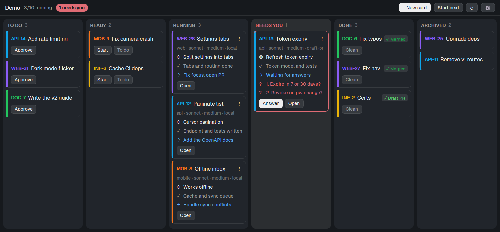

# Herdr board

A kanban of Claude Code agents in a Herdr panel. Each card is a Markdown file; each running card is a normal
interactive Claude Code session in its own git worktree. The panel lists the cards in columns, a click opens a
card's live session, and cards that need you are called out.

This file is the brief for the panel mod. The files next to it are one build of it. The full project (the
`herdr-board.mjs` CLI that owns the cards, the layout, the rules the agents are given) is at
https://github.com/RomainBdt/herdr-board: the panel is only a view on that CLI.

## What you see

A column (268px wide by default, `board-side` slot, between the sidebar and the chat; or six columns in a band above the
tabs, `board-top`) with:

1. **Header:** the board's name, "n/m running", and buttons: refresh, settings (⚙), **+** (new card), **▶** (start next).
2. **Cards** grouped by column: To do, Ready, Running, Needs you, Done, Archived. Each card is a row: id (violet,
   e.g. `HB-24`), title, a left stripe in the column color. To do, Ready and Done cards fit on one line when "compact" is on.
3. **Tags** on Done cards: the done target (None, Local commit, Local + review, Draft PR, PR ready, Merged) each in its
   own color (`#9ca3af`, `#e5b92e`, `#a6c93a`, `#5cc86a`, `#22b8a0`, `#15a34a`), plus Blocked `#f97316` and Not reached `#ef4444`.
4. **Tab bar button:** the second mod, `herdr-board-tabs`, is a copy of Herdr's `tabs` mod with a **Board** button beside
   Files and Changes. It shows or hides the board node and shows a red count while hidden.

## How it behaves

- Every 5 seconds (setting) it runs the board CLI (`node <herdr-board.mjs> --board <folder> ...`) on
  this computer or on a machine over Herdr's `exec` with `on: <machine>`, and redraws. Several boards can be shown at once.
- Click a card: opens its live session (or its card editor, setting "click"). A card in Needs you opens its questions and
  an answer box. **+** opens a New card dialog (repo, title, context, constraints, done target).
- Cards that start needing you give a toast and a sound (setting `notifyNeeds`); the count is shared with the tab bar through
  `shared("herdr-board.needs")`.
- Settings are kept in `shared("herdr-board.settings")`: position (side | top), click, compact, showDone, showArchived (default off),
  refresh, boards `[{machine, script, board}]`. Until a board is set, the panel asks for it in ⚙ → Boards.
- Without a board configured, the panel shows no cards and a hint, never an error.

## Built from

- `mods/herdr-board/main.js` (`View` from `gpui-kit`, inputs from `gpui-base`; `herdr` functions `exec`, `run`, `props`,
  `theme`, `shared`, `setShared`, `agents`, `nextCommand`, `layout`, `machines`, `openOverlay`, `notify`, `playSound`).
  `props.slot` is `side` or `top`; only the copy the Position setting picks runs. The same mod draws its dialogs when
  opened as an overlay.
- `mods/herdr-board-tabs/` (the tab bar copy and four window-button svgs).
- Programs it runs: `node` (the board CLI), `hc`, `git` and `ssh` through the CLI. Nothing else, no network calls of its own.
- `keys.json`: `"ctrl-alt-b": "herdr-board-tabs.toggle"` (not Ctrl+B: Claude Code uses it; ctrl+alt is AltGr on Windows).

## Watch out

- It needs the project's CLI (`herdr-board.mjs`, Node 18+, git, Claude Code, optionally `gh`) and a `board.json`: the mod
  alone draws nothing useful. Set **Board CLI** and **Board folder** in ⚙.
- The layout needs nodes with ids `board-side` and `board-top` (the repo's `layout/board.json` has them) for the Board
  button and the Position setting. Without them the panel still works as a plain mod in any slot.
- The tab bar copy also has a **Git** button. It only shows when the layout has a `graph` node holding the `git-graph`
  mod (github.com/rabeeh-ta/herdr-git-graph, not part of this folder; the repo's `install.sh` copies it).
- Herdr updates to its own tab bar don't reach `herdr-board-tabs`; redo the copy with `herdr-app do mod.clone` and re-add the button.
- Reads files outside its own folder (the board folder and the CLI) and runs programs: read the files before adding it.

## Done when

- `herdr-app check` passes on both mod folders.
- With a board set, cards appear in the right columns and refresh by themselves.
- Clicking a Running card opens its session; **+** creates a card file in the board folder.
- With the panel hidden, the Board button shows the number of Needs you cards, and `ctrl-alt-b` toggles it.
